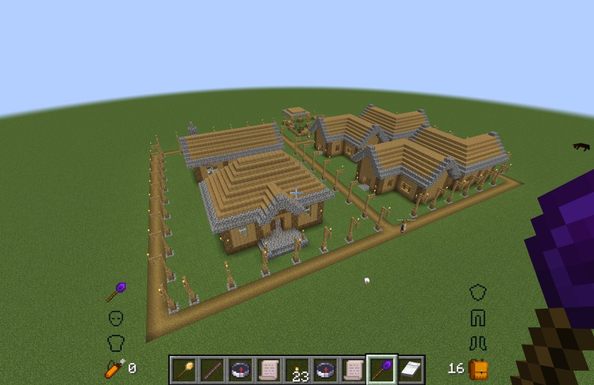
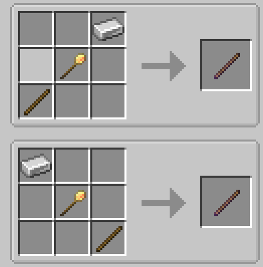
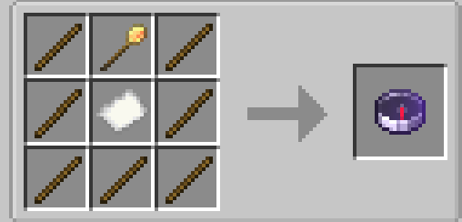
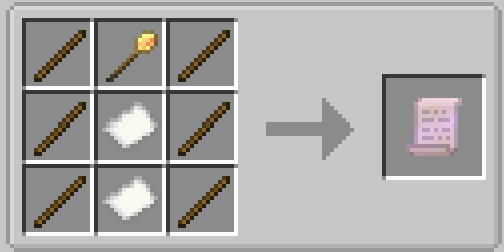
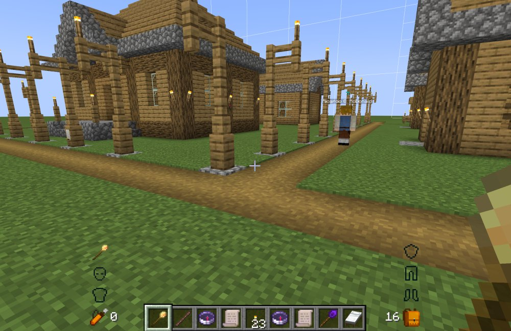
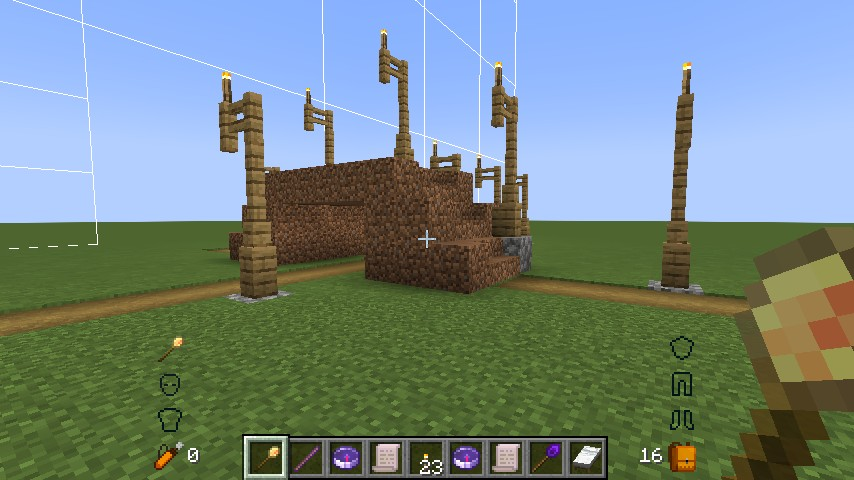

# MineColonies: Crossroads / 模拟殖民地：阡陌纵横

[简体中文](README.md) | **English**

A MineColonies add-on: lay out axis-aligned straight roads with the Road Wand, generate real Structurize blueprints, build them through the native builder flow, and then manage, repair and demolish them from the native Decoration Controller.

Requires Minecraft 1.21.1 · NeoForge 21.1.259 · MineColonies 1.1.1403-1.21.1 · Structurize 1.0.835 · BlockUI 1.0.212 · Domum Ornamentum 1.0.236 (the combination that has actually been tested; the minimum versions declared in the mod metadata do not mean every combination works). This mod cannot run on its own.

*An early colony and the road network joining it.*

## Prerequisites and Installation

1. Install MineColonies and its dependencies (Structurize, BlockUI, Domum Ornamentum), and make sure they run on 1.21.1 / NeoForge 21.1.259.
2. Put `rp_crossroads-0.2.0-beta.1.jar` into `mods/`. **Do not keep a jar under the old name** (`mcreconstruction`): it is incompatible with the latest version, and having both loads two copies of the mod.
3. The client, the server and every multiplayer player must use the same JAR. A mismatched network protocol (13) is rejected at login.

For single-player, steps 1–2 are enough. On a server, ship the same jar to the server and to all players.

## Completion Status and Feedback

### Completion status

The basic gameplay loop works, but treat this as a preview. Only the classic `street` style at 4 blocks wide is supported; any other style or width is refused when generating.

Saved data is still unstable: the road data file was renamed and the row state layout changed, so **saves from the old-named version cannot be read**, and later versions may change it again without migration. Test on a new world, keep backups, and do not use it on a main save.

### Feedback

Report beta issues to **2909987685@qq.com**, ideally with:

- game version, NeoForge version and MineColonies version;
- single-player or dedicated server;
- steps to reproduce, plus screenshots or a recording;
- `logs/latest.log` (and the file from `crash-reports` if it crashed).

## Tools and Recipes

| Item | Purpose |
|---|---|
| Road Wand `road_wand` | Pick A/B to plan a road, edit row by row, view the ghost, open the build tool. |
| Road Surveyor `road_surveyor` | Show a road's extent and manage several at once (Release / Remove). Shift-right-click a Town Hall to bind a colony; while unbound it lists the wilderness roads you may manage. |
| Work Order Scroll `work_order_scroll` | After Shift-right-clicking a Town Hall to bind it, view and bulk-cancel that colony's work orders. |

All three items appear on this mod's creative tab. "Native build tool" below means Structurize's build tool; the same layouts are also listed in the in-game recipe book.

*Road Wand: iron ingot + native build tool + stick. The two mirrored layouts are equivalent.*

*Road Surveyor: native build tool in the top middle, paper in the center, sticks in the other seven slots.*

*Work Order Scroll: native build tool in the top middle, paper in the center and in the bottom middle, sticks in the other six slots.*

## Planning and Building for the First Time

1. With the native build tool, select this mod's structure pack `Crossroads` and place the `road` blueprint from the "initial" category. You get a Decoration Controller and the anchor block.
2. Right-click the controller to create a plan, then Shift-right-click it while holding the wand to bind the wand to this road.
3. Holding the wand, left-click to pick A and Shift-left-click to pick B. The two points fix the horizontal endpoints; they must share an X or a Z axis, up to 256 blocks apart.
4. The anchor row is always flat, with the road surface one block below the anchor; the other rows accumulate step height. The Y you clicked for A/B is not a height target.
5. Right-click air to open the wand panel and adjust mirroring, lamp spacing (1–8; 1 means no lamps) and auto planning. The road is still an unstarted plan at this point.
6. Click "Create blueprint / Open build tool" and pick the blueprint just generated under `generated/` in the native build tool.

Construction uses the three native modes (Complete / Pretty / Survival): in creative it finishes instantly and consumes no materials, while in survival a colony builder works through the order. A wrong blueprint, a moved anchor or a rotated blueprint are refused.

Closing the window before confirming rolls back to unstarted the first time; an already confirmed build keeps going. If it really stops, run Repair: it goes through the same flow without re-sampling the target.

## Editing, Repair and Removal

- Shift-right-click a non-controller block of this road to switch it between flat / step up / step down. The anchor row and any active same-level junction must stay flat. For a road that is already built, enable "Edit Blueprint" in the controller panel first.
- A confirmed road can only be extended or shortened along its axis; it cannot be moved sideways. Editing never touches the world.
- Repair is unavailable before construction starts. It freezes the target again and runs the same native build; editing is blocked while it runs, and the edited/lost counters reset on success.
- The Remove button on the controller: in survival it creates a native REMOVE order; in creative you can then choose a builder demolition or an instant native demolition. Cancelling that second choice does nothing.
- An unstarted road only clears the plan, the controller and the explicit anchor. A built road freezes the demolition target from a trusted snapshot; without one it conservatively keeps the terrain.
- Management records are cleared only after the demolition actually finishes; cancelling does not roll back blocks that are already gone.
- Cancelling work orders from the scroll requires management permission on that colony, and affected online players are notified. The "Upgrade" button is not implemented and stays disabled.

## Junctions and Grade Separations

- A junction forms where the walkable areas of two roads actually overlap, and that stretch is forced flat and level. The automatic solver first follows the terrain slope, then compensates near the junction; if it cannot, it reports a planning conflict.
- The same-level / overpass / underpass relation is stored per road pair and applies to both sides at once. Switching when the conditions are not met reports why and keeps the previous relation.
- If you have no permission on a neighboring road, you can send a request from the panel: 2-second debounce, and no answer within 120 seconds counts as a refusal, with both sides notified. Once approved, both roads may change the shared platform height, and the approval lasts until the road is actually built.
- Without approval the solver strictly avoids the neighboring road: for an overpass it yields to the neighbor's actual surface and tallest lamp, and for an underpass it keeps one block of its own foundation plus this road's lamp space.
- If the solve fails only because one of your own hand-edited rows is in the way, it reports "conflicts with N manually edited rows": click the same relation button again within 60 seconds to confirm the override, which drops only the rows that really must change.
- A grade separation guarantees at least 3 blocks of surface difference and a real 2-block clearance, cell by cell; the upper span gets no foundation or piers, the lower road's lamps are fully avoided, and placeholders protect the other layer's actual structure.
- Demolishing a road rebuilds the blueprints of roads adjacent to it and shows a notice. Demolition and Release only affect truly adjacent roads, never a third one.

*Same-level junction: two roads meet at the same height, and the junction stretch becomes one flat surface.*

*Overpass: the upper road is carried over the lower one, and each layer keeps its own clearance.*

## Permissions and Previews

Permissions are resolved from the controller's position, and colony ownership comes first: having once owned a wilderness road does not override a later colony's management rights.

| Scope | View | Manage and full blueprint |
|---|---|---|
| Inside a colony | ACCESS_HUTS | MANAGE_HUTS |
| Owned wilderness | creator, or a creative OP meeting the vanilla threshold | same |
| Unowned wilderness | public | public |

The native mod's mechanism for bypassing permissions as a creative OP is kept. Greyed-out buttons and the permission display on the client are interaction hints only; the server re-checks every operation.

The wand shows only the road it is bound to, while the surveyor shows your filter range and does not switch as you walk in or out of a colony. Ghosts, index boxes, rollback boxes and arrows are visible within 64 blocks, hidden further out but cached, and restored when you come back.

## Configuration

`config/rp_crossroads-common.toml`:

| Key | Default | Purpose |
|---|---|---|
| `roadAnchorBlock` | `minecraft:stone_bricks` | Initial anchor and controller anchor detection. |
| `lampSpacing` | 4 | Default lamp spacing; the config allows 0–8, ≤1 means no lamps, and the panel offers 1–8. |
| `defaultLampReserveHeight` | 6 | Reserved height for the range and the blueprint. |
| `maxRoadLength` | 256 | Maximum road length; config range 1–2048. |
| `wildernessWorkerMaxDistance` | 256 | For wilderness demolition, the maximum distance from a builder's hut to each target; range 16–2048. |
| `maxGeneratedBlueprintVolume` | 1048576 | Volume cap checked before generating a blueprint; world height is validated as well. |
| `debugLog` | false | Extra diagnostic logging for road generation and completion. |

## Known Limitations

- **Citizen entities disappearing**: occasionally seen after construction is interrupted and restarted; not reliably reproducible and the cause is still unknown. Road recovery itself never deletes, revives or teleports citizens. If you have a lead, email 2909987685@qq.com.

## Documentation

The documents below are written in Chinese.

- [Design document](docs/阡陌纵横-设计文档-0.2.0-beta.1.md) — the rules currently in effect and future boundaries.
- [Implementation progress](docs/阡陌纵横-实现进度.md) — stage completion and acceptance records.
- [Code structure and mechanics](docs/代码结构与机制.md) — how sources, regression tests and scripts are split, call traces and change scope.
- [Contributing and porting](CONTRIBUTING.md), [Changelog](CHANGELOG.md), [Agent collaboration rules](AGENTS.md).

Released under [GPL-3.0](LICENSE).
