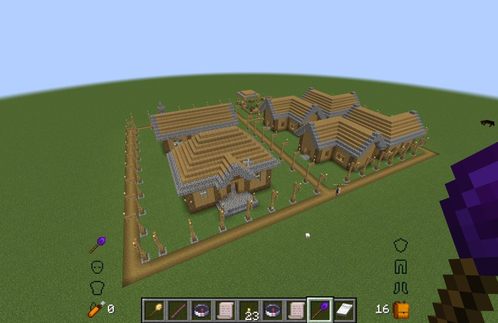
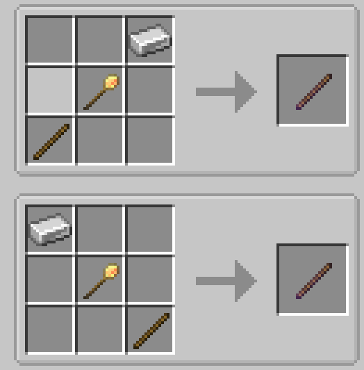
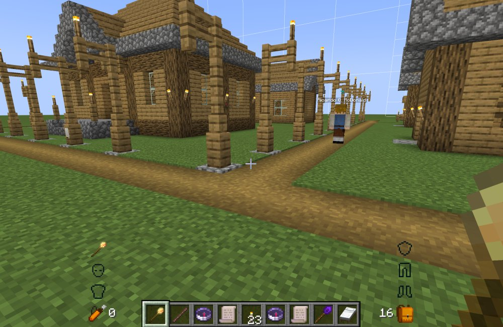
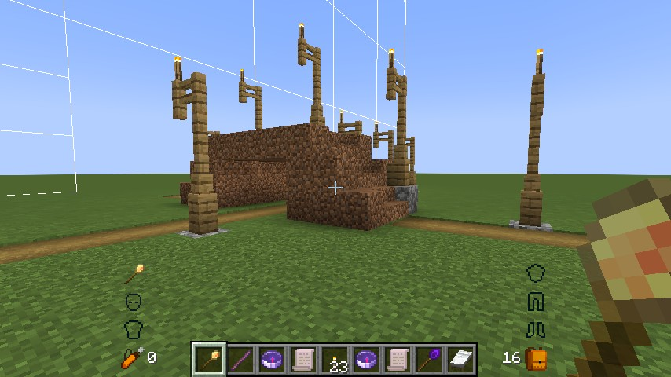

# 模拟殖民地：阡陌纵横 / MineColonies: Crossroads

**简体中文** | [English](README.en.md)

MineColonies 附属扩展：用道路魔棒规划轴向直路，生成真实 Structurize 蓝图，交给原生建造流程施工，建成后用原生装饰控制器长期管理、修复与拆除。

需要 Minecraft 1.21.1 · NeoForge 21.1.259 · MineColonies 1.1.1403-1.21.1 · Structurize 1.0.835 · BlockUI 1.0.212 · Domum Ornamentum 1.0.236（这是已验证的组合，Mod 元数据里的最低版本声明不代表所有组合都测过）。本 Mod 不能独立运行。

*一个殖民地雏形，与几条道路连成的路网。*

## 前置与安装

1. 装好 MineColonies 及其前置（Structurize、BlockUI、Domum Ornamentum），并确认版本在 1.21.1 / NeoForge 21.1.259 上。
2. 把 `rp_crossroads-0.2.0-beta.1.jar` 放进 `mods/`。**不要同时保留旧名称的包**（`mcreconstruction`），它与最新版不兼容，两者并存会各加载一份。
3. 客户端、服务端与每个联机玩家必须使用同一份 JAR：网络协议 13 不一致会在登录阶段被拒绝。

单人游戏完成第 1–2 步即可；开服时服务端与所有玩家同步同一份包。

## 完成进度与问题反馈

### 完成进度

基本游戏流程已实现，但仅供预览。当前只支持经典 street 风格、4 格宽的路面，其他风格与宽度会在生成时被拒绝。

存档仍不稳定：道路数据文件已改名、行状态结构也变了，**旧名称版本的存档读不到**，后续版本还可能再次改动且不做迁移。请用新存档测试，并保留备份，不要用在主力存档上。

### 问题反馈

测试版问题请发邮件到 **2909987685@qq.com**，尽量附上：

- 游戏版本、NeoForge 版本、MineColonies 版本；
- 单人还是专用服务器；
- 复现步骤，以及当时的截图或录像；
- `logs/latest.log`（有崩溃再附 `crash-reports` 里的文件）。

## 三件工具与配方

| 物品 | 用途 |
|---|---|
| 道路魔棒 `road_wand` | 选 A/B 规划道路、逐行编辑、查看幽灵、打开建造工具。 |
| 道路规划仪 `road_surveyor` | 查看道路范围并多选管理（Release / Remove）。Shift 右键市政厅绑定殖民地，未绑定时显示你有权管理的野外道路。 |
| 工单卷轴 `work_order_scroll` | Shift 右键市政厅绑定后，查看并批量取消该殖民地的工单。 |

三件物品都出现在本 Mod 的创造模式分页；配方里的「原生建筑工具」指 Structurize 的建筑工具，摆法也可在游戏内配方书查到。

*道路魔棒：铁锭 + 原生建筑工具 + 木棍，两种镜像摆法等价。*

*道路规划仪：原生建筑工具在顶行中间、纸在正中，其余七格是木棍。*

*工单卷轴：原生建筑工具在顶行中间，正中与底行中间各一张纸，其余六格是木棍。*

## 首次规划与建造

1. 用原生建筑工具选中本 Mod 的包 `Crossroads`，在「初始化」分类下选 `road` 蓝图放置，得到装饰控制器与锚点方块。
2. 右键控制器创建计划，Shift 右键控制器把魔棒绑定到这条道路。
3. 主手持魔棒，左键选 A、Shift 左键选 B。两点决定水平端点，必须同一 X 或 Z 轴，最长 256 格。
4. 锚点那一行固定为平路，路面在锚点下方一格；其余行按台阶累计高度。A/B 的点击高度不作为高程目标。
5. 右键空气打开魔棒面板，调整镜像、灯距（1–8，1 表示不生成灯）与自动规划。此时仍是未开工的计划。
6. 点「创建蓝图 / 打开建造工具」，在原生建筑工具里选 `generated` 目录下刚生成的那份蓝图。

建造沿用原版的三种方式（Complete / Pretty / Survival）：创造模式下即时完成、不消耗材料，生存模式由殖民地建筑工按工单施工。选错蓝图、移动锚点或旋转会被拒绝。

未确认就关窗，首次会退回未开工；已确认的施工不会因为关窗停止。真正中断时用 Repair 重新走同一套流程，不会重新采样替换目标。

## 编辑、修复与删除

- Shift 右键本路的非控制器方块，在平路 / 上台阶 / 下台阶之间切换；锚点行与生效中的同层路口必须保持平路。已建成的路要先在控制器面板打开「修改蓝图」。
- 已确认的道路只能沿原轴伸缩，不能横移改线；编辑阶段不改动世界。
- Repair 在未开工时不可用。它会重新冻结目标再走同一套原生建造，施工期间禁止并发编辑，成功后已编辑与丢失的计数归零。
- 控制器上的拆除按钮：生存直接创建原生 REMOVE 工单；创造点击后可选择建筑工拆除或原生快速拆除。取消二级选择则不执行。
- 未开工的路只清计划、控制器与显式锚点。已建成的路按可信的实际快照冻结拆除目标，没有可信快照时保守保留地形。
- 实际拆除完成后才清管理记录，取消不会回滚已经拆掉的方块。
- 工单卷轴的取消需要该殖民地的管理权限，结果会通知相关在线玩家；「升级」按钮尚未实现，保持禁用。

## 交叉口与分层穿越

- 两条路的可走区域真正交叠就形成路口，路口那一段强制平路等高。自动算法先随地形生成坡度，再在路口接近段补偿；做不到时会提示规划冲突。
- 同层 / 上跨 / 下穿三种关系按道路对保存，改一次两边同时生效；切换时条件不满足会提示并保持原关系。
- 邻路你没有权限时，可以在面板上发出请求：2 秒防抖，120 秒没答复默认拒绝并通知双方。批准后两条路都能改共同的平台高度，授权保留到实际建成。
- 未经批准就严格避开无权限的邻路：上跨按邻路实际路面与最高灯高让位，下穿保留其一格地基与本路的灯空间。
- 如果求解失败只是因为自己的手改行挡住了路，会提示「与 N 行手动修改冲突」：60 秒内再点一次同一个关系按钮即确认覆盖，只丢弃真正需要改变的行。
- 分层逐格保证至少 3 格路面差与实际 2 格通行净空；上层交会跨度不建地基与桥墩，下层完整路灯避让，并以占位保护另一层的实际结构。
- 拆路：重建与被拆除道路相邻的道路的蓝图，并弹出提示。拆除与 Release 都只影响真正相邻的路，不会碰第三条路。

*同层路口：两条路在同一高度交会，路口段并为一段平路。*

*上跨：上层道路架高跨过下层，两层各自留出通行净空。*

## 权限与预览

权限按控制器位置解析，殖民地归属优先；不能因为创建者曾经拥有野外道路就绕过后来的殖民地管理权。

| 范围 | 查看 | 管理及完整蓝图 |
|---|---|---|
| 殖民地内 | ACCESS_HUTS | MANAGE_HUTS |
| 野外有主 | 创建者，或符合原版门槛的创造 OP | 同左 |
| 野外无主 | 公开 | 公开 |

保留了原 Mod 在创造 OP 条件下可绕过权限的机制。客户端的置灰与授权显示只用于交互，服务端每次操作都会复核。

魔棒只显示当前绑定的道路，规划仪显示你的过滤范围，不随玩家站在殖民地内外切换。幽灵、索引框、回退框与箭头在 64 格内可见，远离隐藏并保留缓存，靠近恢复。

## 配置

`config/rp_crossroads-common.toml`：

| 项 | 默认 | 作用 |
|---|---|---|
| `roadAnchorBlock` | `minecraft:stone_bricks` | 初始锚点及控制器锚点识别。 |
| `lampSpacing` | 4 | 默认灯距；配置允许 0–8，≤1 无灯，面板为 1–8。 |
| `defaultLampReserveHeight` | 6 | 范围与蓝图的预留高度。 |
| `maxRoadLength` | 256 | 最大道路长度，配置范围 1–2048。 |
| `wildernessWorkerMaxDistance` | 256 | 野外拆除时，建筑工小屋到每个目标的最大距离，范围 16–2048。 |
| `maxGeneratedBlueprintVolume` | 1048576 | 生成蓝图前的体积上限，另校验世界高度。 |
| `debugLog` | false | 额外的道路生成与完成诊断日志。 |

## 已知限制

- **公民实体消失**：施工中断并重启后偶尔出现，复现不稳定，原因尚未查明。道路恢复本身不会删除、复活或传送公民。如果你掌握相关线索，欢迎发邮件到 2909987685@qq.com。

## 文档入口

- [设计文档](docs/阡陌纵横-设计文档-0.2.0-beta.1.md)：当前有效规则及后续边界。
- [实现进度](docs/阡陌纵横-实现进度.md)：阶段完成度与验收记录。
- [代码结构与机制](docs/代码结构与机制.md)：源码、回归与脚本的分工，机制调用轨迹与修改范围。
- [贡献与版本移植](CONTRIBUTING.md)、[更新记录](CHANGELOG.md)、[代理协作规则](AGENTS.md)。

本 Mod 以 [GPL-3.0](LICENSE) 开源。
