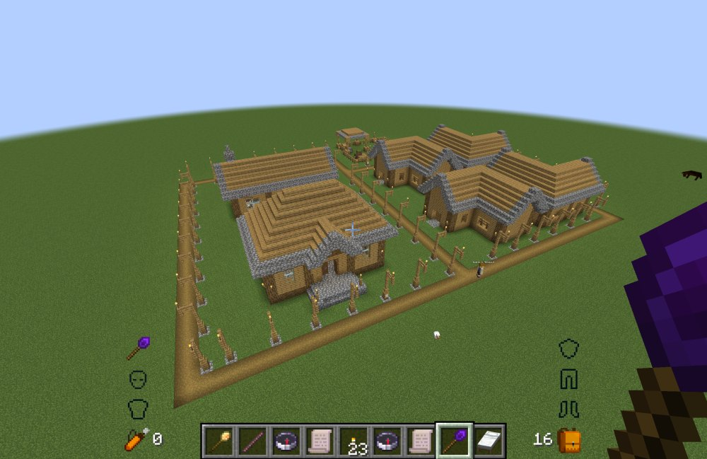
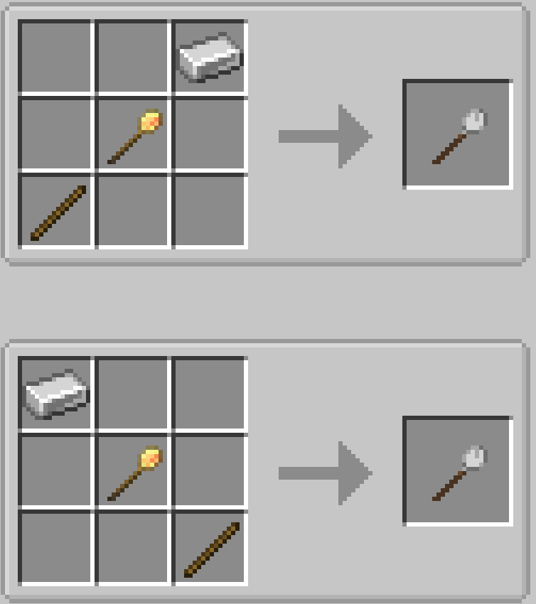
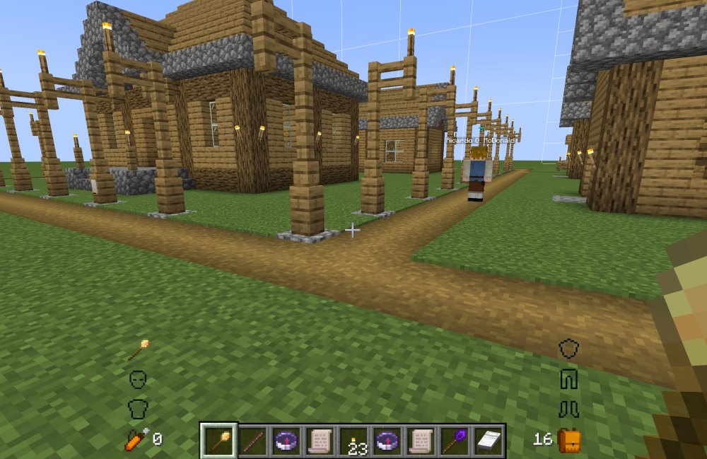
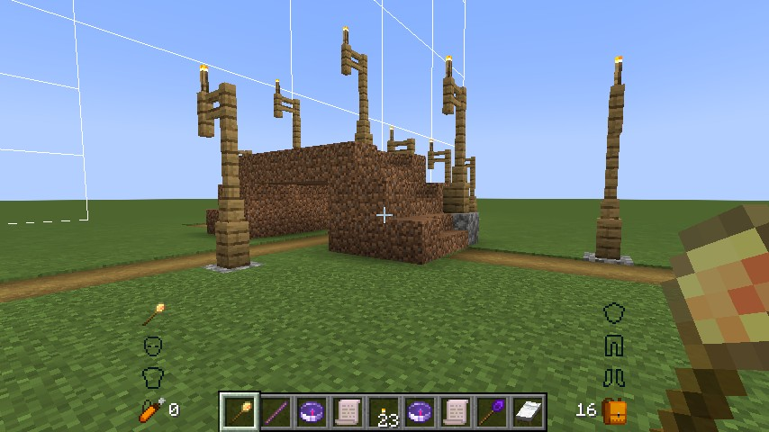

# 模拟殖民地：阡陌纵横 / MineColonies: Crossroads

**简体中文** | [English](README.en.md)

MineColonies 附属扩展：用道路绘制器规划轴向直路，生成真实 Structurize 蓝图，交给原生建造流程施工，建成后用原生装饰控制器长期管理、修复与拆除。

需要 Minecraft 1.21.1 · NeoForge 21.1.259 · MineColonies 1.1.1403-1.21.1 · Structurize 1.0.835 · BlockUI 1.0.212 · Domum Ornamentum 1.0.236（这是已验证的组合，Mod 元数据里的最低版本声明不代表所有组合都测过）。本 Mod 不能独立运行。

*一个殖民地雏形，与几条道路连成的路网。*

## 前置与安装

1. 装好 MineColonies 及其前置（Structurize、BlockUI、Domum Ornamentum），并确认版本在 1.21.1 / NeoForge 21.1.259 上。
2. 把 `rp_crossroads-<版本>.jar`（当前 1.0.0）放进 `mods/`。**不要同时保留旧名称的包**（`mcreconstruction`），它与最新版不兼容，两者并存会各加载一份。
3. 客户端、服务端与每个联机玩家必须使用同一份 JAR：网络协议 19 不一致会在登录阶段被拒绝。

单人游戏完成第 1–2 步即可；开服时服务端与所有玩家同步同一份包。

## 版本状态与问题反馈

### 版本状态

1.0.0 起功能完备。单元按「风格 · 系列 · 等级」取用：随包 `original` 一套风格，系列有街道（4 格宽，1–3 级）与主路（5 格宽，1–4 级）；把带 `units/` 的第三方风格文件夹放进存档包目录，它就会出现在选择窗里。

存档格式自 1.0.0 起冻结：同一大版本内的小版本沿用这套道路数据；只有早期使用旧包名（`mcreconstruction`）的存档读不到。升级前仍建议备份存档。

### 问题反馈

测试版问题请发邮件到 **2909987685@qq.com**，尽量附上：

- 游戏版本、NeoForge 版本、MineColonies 版本；
- 单人还是专用服务器；
- 复现步骤，以及当时的截图或录像；
- `logs/latest.log`（有崩溃再附 `crash-reports` 里的文件）。

## 三件工具与配方

| 物品 | 用途 |
|---|---|
| 道路绘制器 `road_wand` | 选 A/B 规划道路、右键切行类型、Shift 右键切换道路/挖掘/填充模式、查看幽灵。本身没有窗口，建造与管理都在控制器面板。 |
| 道路清单 `road_surveyor` | 查看道路范围并多选管理（Release / Remove）。Shift 右键市政厅绑定殖民地，未绑定时显示你有权管理的野外道路。 |
| 工单清单 `work_order_scroll` | Shift 右键市政厅绑定后，查看并批量取消该殖民地的工单。 |

三件物品都出现在本 Mod 的创造模式分页；配方里的「原生建筑工具」指 Structurize 的建筑工具，摆法也可在游戏内配方书查到。

*道路绘制器：铁锭 + 原生建筑工具 + 木棍，两种镜像摆法等价。*

*道路清单：原生建筑工具在顶行中间、纸在正中，其余七格是木棍。*

*工单清单：原生建筑工具在顶行中间，正中与底行中间各一张纸，其余六格是木棍。*

## 首次规划与建造

1. 用原生建筑工具选中本 Mod 的包 `Crossroads`，在 `initial` 分类下选 `road` 蓝图放置，得到装饰控制器与锚点方块。
2. 右键控制器创建计划，Shift 右键控制器把道路绘制器绑定到这条道路。
3. 主手持道路绘制器，左键选 A、Shift 左键选 B。两点决定水平端点，必须同一 X 或 Z 轴，最长 256 格。
4. 锚点那一行固定为平路，路面在锚点下方一格；其余行按台阶累计高度。A/B 的点击高度不作为高程目标。
5. 右键控制器打开控制器面板，先调整镜像与灯距（1–8，1 表示不生成灯）。此时仍是未开工的计划。
6. 点面板上的「建造」，原生建筑工具会落在 `generated` 目录，里面是这条路**每个等级各一份**的蓝图：一个条目，点开就是 `Level: 1..N`（街道 3 级、主路 4 级），在工具里选这次要建的等级。
7. 工具里还有 `units → original → streets` 分类：本 Mod 的路面 / 台阶 / 灯三份单元预览，只能直接手放对照，不参与建路流程（建路用的是生成蓝图）。

建造沿用原版的三种方式（Complete / Pretty / Survival）：创造模式下即时完成、不消耗材料，生存模式由殖民地建筑工按工单施工。选错蓝图、移动锚点或旋转会被拒绝。

建筑工具的红框（蓝图的 primary 格）落在**控制器预留格**，也就是道路内侧紧邻锚点的那一格，建成后控制器就迁到那里。旧存档已有的道路保持原来的红框位置，直到它第一次 Repair / 升级时自动内移一格——那只是基准框搬家，世界里的方块一格都不动。

未确认就关窗，首次会退回未开工；已确认的施工不会因为关窗停止。真正中断时用 Repair 重新走同一套流程，不会重新采样替换目标。

## 编辑、修复与删除

- 持道路绘制器看向本路任意一格，会高亮整行并在准星下方提示「第 N 行 · 当前类型 → 切换后类型」（N 从道路起点算，不是坐标），按类型着色（平路白 / 上台阶青 / 下台阶橙）。
- 新建道路的名字由词表组合出来：专名 + 通名（`梧桐路`），有时带方位（`东梧桐路`）或序号（`第三街`），前面再加殖民地名。服务器可以在 `config/rp_crossroads/road_names.json` 放一份自己的词表**整份替换**随包词表（改完重启生效；写坏了会回退随包词表并记一条警告），旧存档里已有的路名不变。
- 控制器面板的「风格」「系列」两个按钮打开同一个选择窗（仿原版选包界面：暗色背景、封面卡片）：卡片显示风格的封面、名称、描述与作者，点「选择」进入该风格的系列列表（显示每系列几级），点系列即应用。顶部搜索框按风格名过滤。风格清单来自服务端扫描存档结构包 `units/`，把第三方风格文件夹放进去就会出现；风格可在自己的 `units/<风格>/style.json` 里声明名称/描述/作者/封面。切换按 1 级落地，再由面板「升级」逐级提升（街道 1–3、主路 1–4）；已建成的道路会派生存工单交给建筑工重铺，消耗材料。**宽度不变的切换**（换档、同宽度的风格）直接重铺；**宽度会变或镜像翻转**时先拆后建：服务端先证明新形状仍能与它经过的每条路保持同层高度或原有上下层关系，再派一张拆除工单、完成后自动派建造工单。拆除期间这条路不存在，路口用到的共享格会保护住不被拆掉；证明不通过会直接给出原因，计划与世界都不会变。
- 建造等级在原生工具里选：点「建造」后工具里只有一个条目，展开就是 `Level: 1..N`；只影响这一次建造，建成后仍可升级。
- 地形选区不给按钮：持绘制器 **Shift 右键**（对方块或空气都行）在「道路 → 挖掘 → 填充」之间循环（动作栏提示当前模式，进挖/填时清空 A/B，切回道路模式时自动从这条路重载它自己的 A/B），选好两个角后再**右键方块或空气**即生成选区蓝图并打开建筑工具。选点时世界实时显示选区框（挖=黄色、填=绿色）；确认后由原版创建工单，建筑工按原生流程清空或按建造工小屋设置里的「填充方块」铺满，材料从殖民地仓库出。选区体积上限由 `maxTerrainOrderVolume` 控制（默认 32768）。
- 幽灵蓝图的最大显示距离由客户端配置 `ghostRenderDistance` 控制（默认 64，可调到 256）。
- 面板的「建造 / 升级」是一个按钮：未开工时是「建造」，已规划后是「升级到 N」；施工中显示「施工中」并禁用。「修复」派单重铺当前等级；两者都不需要背包里带建筑工具。调试时用 `/mcrcross dev on` 可切回「冻结后自己用建筑工具放置」的旧流程。
- 右键本路的非控制器方块（道路模式），在平路 / 上台阶 / 下台阶之间切换；锚点行与生效中的同层路口必须保持平路。已建成的路要先在控制器面板打开「修改蓝图」。
- 面板的「镜像」点一下立即生效并写入计划：幽灵当场翻转，重开面板仍是新值；已建成的路改镜像要点「修复」落地，且与改宽度一样走先拆后建。灯距同理，点一次就重算。
- 上跨/下穿路口留 **3 格通行净空**，桥面下方还有一层地基（主路 1–2 级是沙砾，没有它桥面会塌）。两路路面差 5 格：3 格空 + 1 层地基 + 桥面；路灯位置会被避让，桥下不设桥墩。
- 面板底部的「按地形重绘」清掉这条路的**全部**手工行，再按当前地形重新算坡度（不需要手上有绘制器，端点取自计划本身）。路口关系或高度被手工行挡住时会先给一句冲突提示，60 秒内再点同一个按钮即覆盖：先只清路口附近的手工行，不够才清整条路；清空后仍不可行会明确说「不是手工改动造成的」，免得去删根本没挡路的行。
- 「清除」按钮已取消：重新点 A/B 就会覆盖旧选择，要整条放弃用「拆除」。
- 已确认的道路只能沿原轴伸缩，不能横移改线；编辑阶段不改动世界。
- Repair 在未开工时不可用。它会重新冻结目标再走同一套原生建造，施工期间禁止并发编辑，成功后已编辑与丢失的计数归零。
- 别人正在建造或拆除这条路时，控制器面板第二行会写出是谁（`施工中：X（准备中/建造中）`、`拆除中：X`），你点 Repair 被拒时提示里也会带名字；此时要么等，要么让他关掉窗口或完成施工。
- 控制器上的「拆除」与道路清单的「拆除所选」走同一套判定：正常游玩直接派单（生存创建原生 REMOVE 工单；创造同样派建筑工）。只有 `/mcrcross dev on` 时才会弹出「建筑工拆除 / 原生快速拆除」的选择窗，取消则不执行。野外没有殖民地时非开发者模式会拒绝，请用开发者模式拆。
- 未开工的路只清计划、控制器与显式锚点。已建成的路按可信的实际快照冻结拆除目标，没有可信快照时保守保留地形。
- 实际拆除完成后才清管理记录，取消不会回滚已经拆掉的方块。
- 工单清单的取消需要该殖民地的管理权限，结果会通知相关在线玩家。

## 交叉口与分层穿越

- 两条路的可走区域真正交叠就形成路口，路口那一段强制平路等高。自动算法先随地形生成坡度，再在路口接近段补偿；做不到时会提示规划冲突。
- 同层 / 上跨 / 下穿三种关系按道路对保存，改一次两边同时生效；切换时条件不满足会提示并保持原关系。
- 邻路你没有权限时，可以在面板上发出请求：2 秒防抖，120 秒没答复默认拒绝并通知双方。批准后两条路都能改共同的平台高度，授权保留到实际建成。
- 未经批准就严格避开无权限的邻路：上跨按邻路实际路面与最高灯高让位，下穿保留其一格地基与本路的灯空间。
- 如果求解失败只是因为自己的手改行挡住了路，会提示「与 N 行手动修改冲突」：60 秒内再点一次同一个关系按钮即确认覆盖，只丢弃真正需要改变的行。
- 分层逐格保证至少 **5 格路面差**（3 格通行 + 1 层地基 + 桥面）与 3 格实际通行净空；上层交会跨度不建地基与桥墩，下层完整路灯避让，并以占位保护另一层的实际结构。
- 拆路：重建与被拆除道路相邻的道路的蓝图，并弹出提示。拆除与 Release 都只影响真正相邻的路，不会碰第三条路。

*同层路口：两条路在同一高度交会，路口段并为一段平路。*

*上跨：上层道路架高跨过下层，两层各自留出通行净空。*

## 权限与预览

权限按控制器位置解析，殖民地归属优先；不能因为创建者曾经拥有野外道路就绕过后来的殖民地管理权。

| 范围 | 查看 | 管理及完整蓝图 |
|---|---|---|
| 殖民地内 | ACCESS_HUTS | MANAGE_HUTS |
| 野外有主 | 创建者，或符合原版门槛的创造 OP | 同左 |
| 野外无主 | 公开 | 公开 |

保留了原 Mod 在创造 OP 条件下可绕过权限的机制。客户端的置灰与授权显示只用于交互，服务端每次操作都会复核。

道路绘制器只显示当前绑定的道路，道路清单显示你的过滤范围，不随玩家站在殖民地内外切换。幽灵、索引框、回退框与箭头在 64 格内可见，远离隐藏并保留缓存，靠近恢复。

## 配置

`config/rp_crossroads-common.toml`：

| 项 | 默认 | 作用 |
|---|---|---|
| `roadAnchorBlock` | `minecraft:dirt` | 初始锚点及控制器锚点识别。 |
| `lampSpacing` | 4 | 默认灯距；配置允许 0–8，≤1 无灯，面板为 1–8。 |
| `defaultLampReserveHeight` | 6 | 范围与蓝图的预留高度。 |
| `maxRoadLength` | 256 | 最大道路长度，配置范围 1–2048。 |
| `wildernessWorkerMaxDistance` | 256 | 野外拆除时，建筑工小屋到每个目标的最大距离，范围 16–2048。 |
| `maxGeneratedBlueprintVolume` | 1048576 | 生成蓝图前的体积上限，另校验世界高度。 |
| `maxTerrainOrderVolume` | 32768 | 单次挖掘 / 填充选区的体积上限。 |
| `ghostRenderDistance` | 64 | 客户端：幽灵预览的最大显示距离（16–256）。 |
| `debugLog` | false | 额外的道路生成与完成诊断日志。 |

## 已知限制

- **公民实体消失**：施工中断并重启后偶尔出现，复现不稳定，原因尚未查明。道路恢复本身不会删除、复活或传送公民。如果你掌握相关线索，欢迎发邮件到 2909987685@qq.com。

## 文档入口

- [设计文档](docs/阡陌纵横-设计文档-1.0.0.md)：当前有效规则及后续边界。
- [实现进度](docs/阡陌纵横-实现进度.md)：阶段完成度与验收记录。
- [代码结构与机制](docs/代码结构与机制.md)：源码、回归与脚本的分工，机制调用轨迹与修改范围。
- [贡献与仓库说明](CONTRIBUTING.md)、[更新记录](CHANGELOG.md)、[代理协作规则](AGENTS.md)。

本 Mod 以 [GPL-3.0](LICENSE) 开源。
